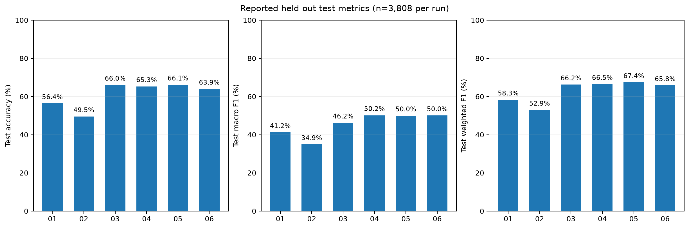

# ResNet50 vs. DenseNet121 on ISIC 2019

An ongoing comparative study of **eight-class dermoscopic image classification**. Six experiments compare training from scratch, ImageNet transfer learning, and training-time augmentation using ResNet50 and DenseNet121.

- **Author** · [Manan Paliwal](https://github.com/Manan-Paliwal)
- **Framework** · PyTorch and TorchVision
- **Milestone** · Six completed runs with audited held-out results

## Held-out results

All six experiments were evaluated on the same 3,808-image internal test split. The audit recomputed the classification metrics from saved predictions and checked them against the aggregate artifacts. Macro F1 weights each diagnostic category equally.

| Experiment | Training recipe | Best val macro F1 | Test accuracy | Test macro F1 | Test weighted F1 |
|---|---|---:|---:|---:|---:|
| [01](notebooks/01_ResNet50_Scratch.ipynb) | ResNet50 from scratch | 40.46% | 56.36% | 41.20% | 58.29% |
| [02](notebooks/02_DenseNet121_Scratch.ipynb) | DenseNet121 from scratch | 37.73% | 49.53% | 34.91% | 52.92% |
| [03](notebooks/03_ResNet50_Transfer.ipynb) | ResNet50 transfer | 49.04% | 66.05% | 46.23% | 66.20% |
| [04](notebooks/04_DenseNet121_Transfer.ipynb) | DenseNet121 transfer | 51.01% | 65.28% | **50.15%** | 66.45% |
| [05](notebooks/05_ResNet50_Transfer_Augmentation.ipynb) | ResNet50 transfer + augmentation | **53.17%** | **66.12%** | 49.97% | **67.38%** |
| [06](notebooks/06_DenseNet121_Transfer_Augmentation.ipynb) | DenseNet121 transfer + augmentation | 52.79% | 63.94% | 50.03% | 65.77% |



- **Transfer runs scored higher than scratch runs.** Test macro F1 increased by 5.03 percentage points for ResNet50 (01 → 03) and 15.24 for DenseNet121 (02 → 04). These runs differ in their training protocols, and the DenseNet121 comparison spans Apple MPS and NVIDIA CUDA.
- **The DenseNet121 augmentation result depends on the metric.** Relative to Experiment 04, Experiment 06 gained 1.78 points in validation macro F1 and 5.09 points in test macro recall. Its test accuracy fell by 1.34 points and its test macro F1 fell by 0.13 points.
- **Experiments 04–06 were close on test macro F1.** Their scores span only 0.18 percentage points. For 04 → 06 the paired 95% test-group bootstrap interval for the macro F1 change was −3.40 to +3.20 points. This interval describes uncertainty across test groups for the fitted models. Seed-to-seed training variation remains unmeasured.

See the [research audit](docs/research-audit.md) for per-class results, training trends, paired comparisons, and sensitivity checks.

## Dataset and protocol

The study uses **25,331 dermoscopic images** from the public labeled ISIC 2019 training release. The internal evaluation covers eight diagnoses. The official challenge evaluation used a separate test set with an additional outlier category. [ISIC 2019 challenge](https://challenge.isic-archive.com/landing/2019/)

[Notebook 00](notebooks/00_Dataset_Preparation.ipynb) builds a class-stratified split at lesion-group level using seed 42. The permanent partitions contain **17,705 training**, **3,818 validation**, and **3,808 test** images. Image ID, assigned split group, known lesion ID, and exact cached JPEG hashes were checked across partitions. The **2,084** images with missing lesion IDs use image-level fallback groups. This leaves possible relationships between images that the available metadata and exact-hash checks cannot detect.

| Code | Diagnosis | Test images |
|---|---|---:|
| MEL | Melanoma | 648 |
| NV | Melanocytic nevus | 1,951 |
| BCC | Basal cell carcinoma | 507 |
| AK | Actinic keratosis | 147 |
| BKL | Benign keratosis | 404 |
| DF | Dermatofibroma | 29 |
| VASC | Vascular lesion | 33 |
| SCC | Squamous cell carcinoma | 89 |

Models receive 224 × 224 inputs from a 256 × 256 JPEG cache with ImageNet normalization. Runs use batch size 32, AdamW, and class-weighted cross-entropy. Class weights come from inverse frequencies in the training split. Transfer runs fit an eight-output classifier with a frozen backbone and frozen BatchNorm statistics, then fine-tune from the best Stage 1 checkpoint with lower, separate learning rates. Experiment 03 evaluates its Stage 2 winner. Experiments 04–06 select between the stage winners using validation macro F1.

Augmentation in Experiments 05 and 06 applies 50% horizontal and vertical flips, bilinear rotation up to ±20° with reflection padding, and modest brightness, contrast, and saturation jitter during training. Validation and test preprocessing are deterministic.

## Reproduce the figures and workflow

- [Aggregate results](results/) contains the historical Experiments 01–03 records and [cloud results](results/cloud/) for 04–06, including histories, configurations, test summaries, per-class scores, and confusion matrices. [Figures](figures/) contains training curves and aggregate evaluations.
- The public milestone contains cleaned notebooks and aggregate artifacts. Obtain the images, ground truth, and metadata from the dataset provider, following the provider’s licenses and attribution requirements. Dataset and model artifacts are kept outside this repository. [Official ISIC datasets](https://challenge.isic-archive.com/data/#2019)

From the repository root, install the notebook dependencies and regenerate the figures from saved result files:

```bash
python -m pip install -r requirements.txt
python scripts/generate_figures.py
```

To reproduce training:

1. Open the notebooks from the repository root or configure their project and dataset paths explicitly. Place the downloaded ISIC assets in the layout described in [Notebook 00](notebooks/00_Dataset_Preparation.ipynb).
2. Reuse the original split manifests and image cache if available to you. Otherwise run Notebook 00 to regenerate the group-level split, then use the cache-building section of Notebook 01 to prepare the resized JPEGs.
3. Run the selected training notebook with a compatible PyTorch and TorchVision device build. Use fresh model and results directories to preserve the published artifacts. Adjust the legacy 01–03 output paths before training. The appendices in Notebooks 04–06 describe checkpoint recovery on persistent storage.
4. Match the recorded run settings for historical reproduction. Experiments 01–03 used MPS and zero DataLoader workers. The RTX 3090 runs for Experiments 04–06 used four workers with CUDA AMP disabled. The saved cloud configurations describe the executed settings.

## Limitations and ongoing work

- The experiments cover one internal dataset split and one training seed per recipe. The 29 dermatofibroma and 33 vascular lesion test images make their class-level scores sensitive to individual errors.
- Hardware, numerical precision policy, pretrained weight variants, and loss aggregation limit cross-experiment interpretation. Experiments 04 and 06 normalize weighted loss across the full split. Experiment 05 averages weighted batch means by sample count. Historical wall-clock times and GPU epoch times should be interpreted with their recorded environments.
- The audit found duplicate cached images within partitions, including two same-byte groups with conflicting labels in training. Exact hashes cannot rule out near-duplicates. Sensitivity analyses and the original result conventions are explained in the [research audit](docs/research-audit.md).
- This milestone addresses offline educational research. Clinical applicability would require independent external validation, calibration, and prospective evaluation.

Ongoing work includes repeated-seed training, stricter duplicate and grouping checks, and evaluation on an independent dataset.
